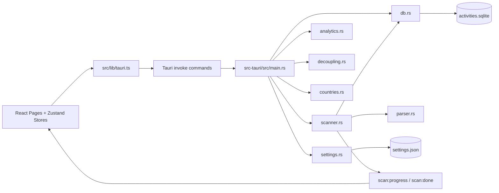

# Trajectory Developer Guide

> Last verified against the codebase: **October 8, 2026**

This guide is for contributors working on Trajectory's desktop app codebase.
It is intentionally practical: what exists today, how it fits together, and how to extend it safely.

## 1. Quick Start

### Prerequisites

- Node.js 22.12+
- Rust stable toolchain (1.88+; `rust-toolchain.toml` includes `rustfmt` and `rust-analyzer`)
- macOS (primary supported platform for local dev)
- GitHub Actions for preview/release builds on macOS, Windows, and Linux

### Install and run

```bash
npm ci
npm run tauri dev
```

### Quality checks

```bash
npm run check
```

This runs:

- App and lockfile version alignment (`npm run check:versions`)
- TypeScript typecheck (`npm run typecheck`)
- Activity metrics, chart interaction, request handling, and analytics cache tests (`npm run test:activity-metrics`)
- Rust check and regression tests (`npm run check:rust`, `npm run test:rust`)
- Rust formatting (`npm run check:rust-format`)

### Build local production artifacts

```bash
npm run tauri build
```

Tauri validates versions and builds the frontend before compiling the desktop app.
Artifacts for the current platform are created under:

- `src-tauri/target/release/bundle/macos/*.app`
- `src-tauri/target/release/bundle/dmg/*.dmg`
- `src-tauri/target/release/bundle/nsis/*.exe`
- `src-tauri/target/release/bundle/msi/*.msi`
- `src-tauri/target/release/bundle/deb/*.deb`
- `src-tauri/target/release/bundle/appimage/*.AppImage`

## 2. Product Scope (Current)

Trajectory is a local-first desktop app for exploring activity files.

Current stack:

- **Shell/runtime:** Tauri v2
- **Backend:** Rust
- **Frontend:** React + TypeScript + Vite + Tailwind
- **Storage:** SQLite + JSON settings

Supported activity files:

- `.tcx`
- `.txc` (accepted alias)
- `.fit`

Important behavior:

- The selected import folder is treated as read-only input.
- App data is stored in app-owned directories (`activities.sqlite`, `settings.json`).
- No cloud backend. No telemetry service.
- Map views still fetch external map tiles (OSM/CARTO) at runtime.

## 3. Repository Map

| Path | Purpose |
| --- | --- |
| `src/` | React frontend |
| `src-tauri/` | Tauri shell + Rust backend |
| `docs/DEVELOPER_GUIDE.md` | This document |
| `.github/workflows/ci.yml` | Frontend typecheck/tests + Rust check/formatting |
| `.github/workflows/preview-bundles.yml` | Manual preview bundle pipeline for artifact testing |
| `.github/workflows/release.yml` | Tag-based macOS/Windows/Linux release pipeline |

### Project Structure

```text
.
├── src/
│   ├── components/      # shared UI building blocks
│   ├── lib/             # Tauri bridge wrappers and frontend utilities
│   ├── pages/           # route-level page components
│   ├── store/           # Zustand app/UI/analytics state
│   ├── types.ts         # frontend contract mirror for Rust DTOs
│   └── App.tsx          # app bootstrap, routing, startup scan flow
├── src-tauri/
│   ├── src/
│   │   ├── main.rs      # Tauri command registration and app wiring
│   │   ├── models.rs    # Rust DTOs shared across commands/modules
│   │   ├── scanner.rs   # file discovery + incremental/full scan logic
│   │   ├── parser.rs    # TCX/FIT parsing into normalized activities
│   │   ├── db.rs        # SQLite schema, migrations, and query layer
│   │   ├── analytics.rs # advanced analytics computation
│   │   ├── decoupling.rs # pace-HR decoupling and heart-rate drift
│   │   ├── countries.rs # offline country lookup and activity aggregation
│   │   └── settings.rs  # settings load/save and defaults
│   ├── Cargo.toml
│   └── tauri.conf.json
├── docs/
│   └── DEVELOPER_GUIDE.md
└── .github/
    └── workflows/
        ├── ci.yml
        ├── preview-bundles.yml
        └── release.yml
```

## 4. Architecture At A Glance



## 5. Frontend Overview

### App shell and routing

`src/App.tsx` handles:

- app bootstrap (`useAppStore.init()`)
- dark/light theme application
- accent theme CSS variable application
- automatic startup scan (once per selected import folder path)
- startup advanced analytics cache warm-up after a completed scan
- route rendering via `HashRouter`

Current routes:

| Route | Page |
| --- | --- |
| `/` | `DashboardPage` |
| `/activities` | `ActivitiesPage` |
| `/activities/:id` | `ActivityDetailPage` |
| `/heatmap` | `HeatmapPage` |
| `/analytics` | `AdvancedAnalyticsPage` |
| `/settings` | `SettingsPage` |

### Tauri bridge source of truth

`src/lib/tauri.ts` defines command wrappers and event listeners.

Current wrappers:

- `getSettings`
- `setImportFolder`
- `setDarkMode`
- `setAccentTheme`
- `setHeatmapFullOpacity`
- `setChartMaxSamples`
- `setChartOutlierRemoval`
- `setHeartRateZoneUpperBoundsBpm`
- `scanImportFolder`
- `listActivities`
- `getActivity`
- `getActivitySamples`
- `getAerobicDecoupling`
- `getHeatmapData`
- `getCountryActivityData`
- `runAdvancedAnalytics`
- `exportAnalyticsJson`
- `onScanProgress`

### Global state stores

| Store | File | Responsibility |
| --- | --- | --- |
| App/runtime state | `src/store/useAppStore.ts` | settings, scan lifecycle, in-memory activity cache, in-memory analytics cache |
| Persisted UI state | `src/store/useUiStateStore.ts` | filters, tabs, navigation memory, dashboard mode, heatmap controls |
| Persisted analytics definitions | `src/store/useAdvancedAnalyticsStore.ts` | metrics/streaks/charts definitions, selection, auto-run |

Advanced analytics cache keys include the complete request plus the import folder,
last scan timestamp, and HR zones (`src/lib/analytics/cacheKey.ts`). Startup warm-up
and the analytics page share these keys; startup and automatic runs discard stale responses.

### Page behavior highlights

- **Onboarding:** directory picker + recursive toggle.
- **Settings:** tabs for Import, Appearance, Athlete Metrics.
  - Import actions: incremental rescan and full cache clear + rescan.
  - Appearance includes chart sample cap slider, chart outlier-removal toggle, and heatmap opacity preference.
  - Athlete Metrics manages heart-rate zone cutoffs.
- **Dashboard:** year/month calendar views with aggregate metrics and drilldowns.
- **Activities:** filter + sort table, navigation into details.
- **Activity Detail:**
  - loads summary/track and full-resolution samples together via `useActivityData`; activity changes and rescans discard stale requests
  - derives zoomed chart samples in memory; `chartMaxSamples` caps rendering after clipping/interpolating the visible endpoints
  - offers distance charts whenever cumulative distance is usable, including indoor activities; time charts can collapse explicit paused segments into moving time
  - dragging updates the selection highlight; release commits the zoom, resamples the chart, and updates full-resolution segment metrics, HR zones, and decoupling using shared elapsed-time boundaries (`src/lib/activityDetail/useActivityChartData.ts`)
  - labels selected metrics with `(Segment)`; reset restores workout summary values; missing segment data is shown as unavailable
  - computes segment distance from cumulative-distance endpoints and average speed/pace from distance and moving time; distance/altitude interpolation allocates recorded changes across active time, excluding recorded pauses
  - offers pace-HR decoupling and heart-rate drift for the workout or selection; requests are debounced and stale responses are discarded
- **Heatmap:** map rendering with date/category/sport filters.
  - Routes renders the GPS-track overlay.
  - Countries highlights every country containing matching GPS samples.
  - Time spent shades those countries using elapsed time between consecutive activity samples.
- **Advanced Analytics:** custom metrics/streaks/charts builder + preview, selective JSON import/export.

## 6. Backend Overview

### Main app entry (`src-tauri/src/main.rs`)

Responsibilities:

- initialize app state and storage paths
- initialize SQLite schema
- ensure default settings file exists
- register Tauri command handlers
- validate input settings (accent theme, chart sample limits, HR zones)

### Storage and rescan behavior

- `activities.sqlite` stores normalized activity summaries plus per-sample data.
- Activity rows also track a parser version and serialized pause segments.
- Incremental scans reparse unchanged source files automatically when the parser version changes, so importer fixes can roll forward without requiring a manual full rescan.

Registered Tauri commands:

| Command | Purpose |
| --- | --- |
| `get_settings` | Read settings JSON |
| `set_import_folder` | Set folder + recursive scan option |
| `set_dark_mode` | Update theme mode |
| `set_accent_theme` | Update accent palette |
| `set_heatmap_full_opacity` | Toggle heatmap opacity mode |
| `set_chart_max_samples` | Persist chart sample cap |
| `set_chart_outlier_removal` | Toggle robust outlier suppression in Activity Detail charts |
| `set_heart_rate_zone_upper_bounds_bpm` | Save Z1-Z4 upper bpm limits (Z5 is everything above Z4) |
| `scan_import_folder` | Run incremental/full scan |
| `list_activities` | Query activity list |
| `get_activity` | Get activity summary + route track |
| `get_activity_samples` | Query/downsample chart samples |
| `get_aerobic_decoupling` | Calculate pace-HR decoupling and heart-rate drift from full-resolution samples |
| `get_heatmap_data` | Return heatmap tracks |
| `get_country_activity_data` | Aggregate GPS samples into country activity counts and elapsed time |
| `run_advanced_analytics` | Compute analytics payload |
| `export_analytics_json` | Write exported analytics JSON file |


### Decoupling (`src-tauri/src/decoupling.rs`)

- compares equal active-time halves after excluding recorded pauses
- heart-rate drift measures the percentage rise in average HR; pace-HR decoupling measures the percentage decline in speed/HR efficiency
- requires at least three samples, 60 active seconds, and 80% valid coverage per half; gaps over 30 seconds count as unobserved time
- returns nullable values with typed unavailability reasons when HR or paired speed/HR coverage is insufficient

### Scanner (`src-tauri/src/scanner.rs`)

What it does:

- discovers activity files (`.tcx`, `.txc`, `.fit`)
- supports recursive/non-recursive scan modes
- canonicalizes paths when possible
- compares `(source_path, source_mtime, source_size)` for incremental detection
- prunes deleted source files from DB on incremental scans
- supports full rebuild (`full_rescan = true`)
- emits progress/done events:
  - `scan:progress` `{ parsed, total, currentFile }`
  - `scan:done` `{ added, updated, skipped, errors }`

### Parser (`src-tauri/src/parser.rs`)

Parses TCX and FIT into normalized activity models.

Notable behavior:

- derives category/title fallbacks
- computes duration, moving time, distance, elevation, speed, HR stats
- supports summary-only FIT import if no point records are present
- parses cadence and power when available
- reconstructs missing cumulative distance (including GPS-derived distance) only between updates at most 30 seconds apart, without crossing recorded pauses; leading, trailing, and longer gaps remain missing, and recorded zero speed is preserved
- downsamples stored route track to `MAX_UI_POINTS = 2000`
- preserves full sample rows for DB insert (sampling happens at query time)

### Database layer (`src-tauri/src/db.rs`)

Responsibilities:

- schema creation and migrations (`DB_SCHEMA_VERSION = 3`)
- upsert activity + sample rows
- query list/detail/heatmap/sample windows
- query-side downsampling

Tables:

- `activities`
- `activity_samples`

Recent schema/migration coverage includes:

- `category`, `title`, `min_hr`, `moving_duration_seconds`
- sample-level `cadence`, `power_watts`
- activity-level `pause_segments_json`, `parser_version`

Sampling notes:

- `get_activity` returns summary + track (no samples)
- `get_activity_samples` returns filtered/downsampled sample windows
- `downsample: false` returns full-resolution samples; Activity Detail uses these for metrics and applies its chart cap in memory
- default chart sample cap is `2000`, clamped in Rust (`50..=20000`)
- settings validation in `main.rs` accepts `100..=20000`

### Settings persistence (`src-tauri/src/settings.rs`)

- `load_settings(path)` reads JSON, falling back to defaults when missing.
- `save_settings(path, settings)` writes formatted JSON.

Default settings (current):

- `scanRecursive: true`
- `darkMode: false`
- `accentTheme: "citrus-orange"`
- `heatmapFullOpacity: false`
- `chartMaxSamples: 2000`
- `chartOutlierRemoval: true`
- `heartRateZoneUpperBoundsBpm: [120, 140, 160, 180]`

## 7. Contracts Between Frontend and Rust

Mirror files:

- Rust: `src-tauri/src/models.rs`
- TypeScript: `src/types.ts`

When changing any command payload or DTO:

1. Update Rust model(s) in `src-tauri/src/models.rs`.
2. Update backend behavior (`main.rs`, `db.rs`, `analytics.rs`, etc.).
3. Update TypeScript interfaces in `src/types.ts`.
4. Update bridge wrappers in `src/lib/tauri.ts`.
5. Update UI/store consumers.

Serialization uses camelCase mapping (`serde(rename_all = "camelCase")`).

The decoupling DTOs are `AerobicDecouplingRequest`, `AerobicDecouplingRange`,
`AerobicDecouplingResponse`, and `AerobicDecouplingUnavailableReason`. Range axes
are `elapsedTime`, `movingTime` (seconds), or `distance` (kilometers); Activity Detail
converts its selection to elapsed time before invoking the command.

Frontend segment metrics and HR zones use adjacent active sample intervals,
excluding gaps over 300 seconds. Missing readings break the held sensor value;
sensor averages/extrema require 80% coverage, while zones report tracked time.
These rules are separate from decoupling's stricter 30-second gap limit.

## 8. Data Storage

App-managed files are created using Tauri path APIs:

- DB: app data directory, file `activities.sqlite`
- settings: app config directory, file `settings.json`

Design choices:

- tracks are stored as JSON in `activities.track_json` (map-friendly payload)
- detailed samples are stored in `activity_samples`
- maps use sampled tracks; Activity Detail keeps full samples for metrics and caps chart rendering separately

## 9. Scan Lifecycle

### Automatic startup scan

1. App loads settings.
2. If import folder exists, `App.tsx` triggers a scan once for that folder path.
3. UI receives scan progress events.
4. On completion, caches are invalidated and `lastScanTimestamp` updates.
5. App optionally pre-warms advanced analytics cache for active definitions.

### Manual scan

- Triggered in Settings -> Import -> `Rescan`.
- Uses incremental behavior.

### Full rebuild

- Triggered in Settings -> Import -> `Clear Cache + Full Rescan`.
- Clears `activities` + `activity_samples`, then reimports all files.

## 10. Build, CI, Release

### Local build flow

- `npm ci`
- `npm run tauri dev` for development
- `npm run check` for quality gate
- `npm run tauri build` for local production bundles

Per-platform `src-tauri/tauri.*.conf.json` files select installer formats; macOS
uses ad-hoc signing. Linux CI installs prerequisites with
`bash scripts/install-tauri-linux-deps.sh` (Ubuntu/Debian).

### CI (`.github/workflows/ci.yml`)

- frontend quality job on Ubuntu:
  - `npm ci`
  - `npm run check:versions`
  - `npm run typecheck`
  - `npm run test:activity-metrics`
  - `npm run build`
- rust quality job on Ubuntu, macOS, and Windows:
  - Linux runner installs Tauri system dependencies with `scripts/install-tauri-linux-deps.sh`
  - `cargo check --locked --manifest-path src-tauri/Cargo.toml`
  - `cargo test --locked --manifest-path src-tauri/Cargo.toml`
  - `cargo fmt --manifest-path src-tauri/Cargo.toml --all -- --check`

### Preview bundles (`.github/workflows/preview-bundles.yml`)

Triggered manually from GitHub Actions.

Builds downloadable artifacts without creating a GitHub release:

- macOS: `.app` + `.dmg` (optional)
- Windows: `.exe` (NSIS) + `.msi`
- Linux: `.deb` + `.AppImage`

Each job runs `npm run check` before packaging with the locked Cargo dependencies.
The macOS job verifies the signature and archives the `.app` as `.app.tar.gz` to preserve permissions and symlinks.

Use this workflow to validate that a branch is release-ready and hand the generated bundles to testers before tagging a real release.

### Release (`.github/workflows/release.yml`)

Triggered by tags matching `v*`.

Pipeline verifies version alignment across:

- git tag (without `v` prefix)
- `package.json`
- `package-lock.json` (top level and root package)
- `src-tauri/tauri.conf.json`
- `src-tauri/Cargo.toml`
- `src-tauri/Cargo.lock` (the `trajectory` package)

The portable validator is also available locally as `npm run check:versions`.

Each job runs `npm run check` with the tag as the expected version before building
and publishing platform bundles via `tauri-apps/tauri-action`, using the locked Cargo dependencies:

- macOS: `.app` + `.dmg` with ad-hoc signing; headless packaging skips Finder window layout
- Windows: `.exe` (NSIS) + `.msi`
- Linux: `.deb` + `.AppImage`

## 11. Common Extension Tasks

### Add a new Tauri command

1. Define/extend DTOs in `src-tauri/src/models.rs`.
2. Implement behavior in backend modules.
3. Add `#[tauri::command]` in `main.rs` and register it.
4. Add typed wrapper in `src/lib/tauri.ts`.
5. Mirror types in `src/types.ts`.
6. Consume in store/page/component.

### Add a new persisted setting

1. Add default + field in Rust `Settings`.
2. Add setter command in `main.rs`.
3. Mirror in TypeScript `Settings` interface.
4. Add UI controls and app-store update action.
5. Use the setting in rendering/query logic.

### Add a new activity filter

1. Update Rust + TS filter models.
2. Extend SQL predicates in `db::list_activities` and/or `db::get_heatmap_data`.
3. Pass through bridge wrapper.
4. Wire into UI state and page controls.
